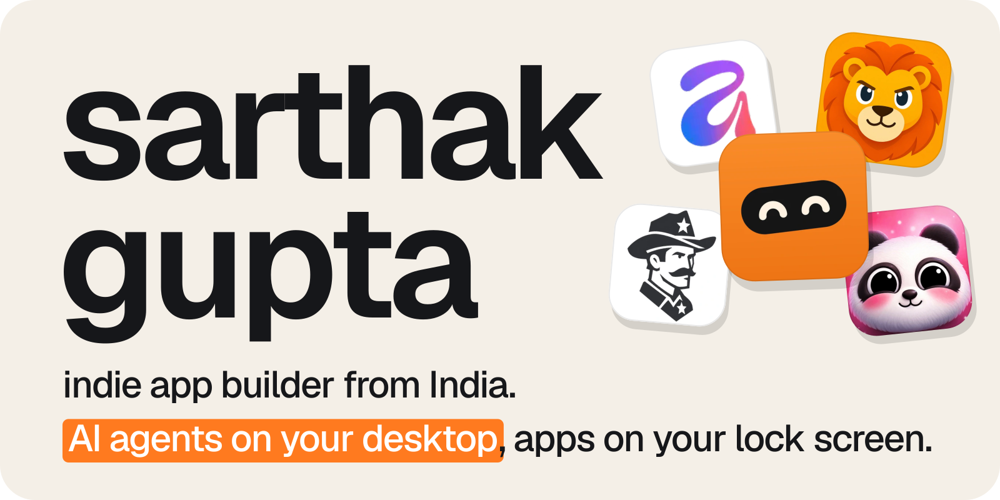
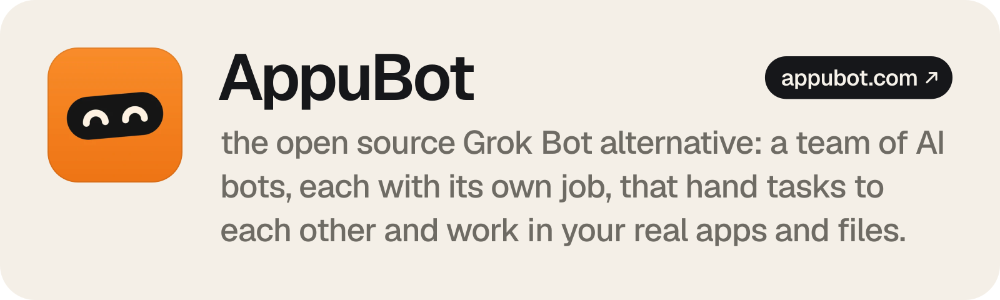
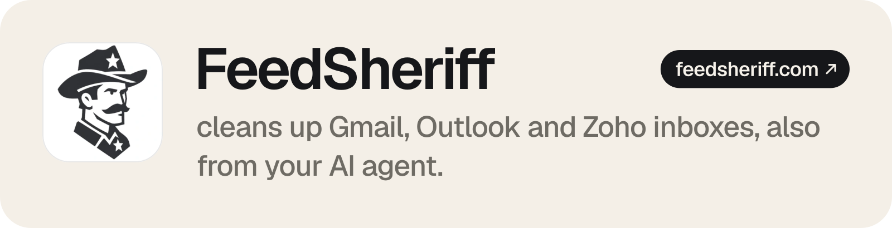
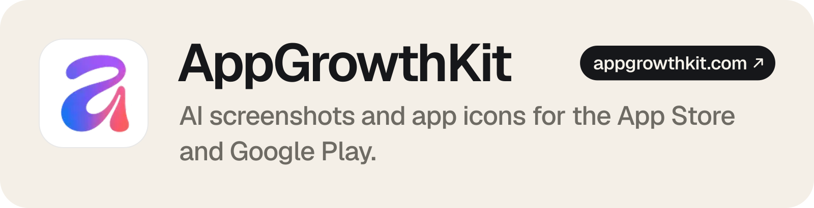
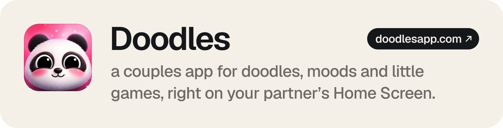
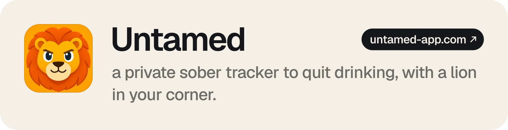
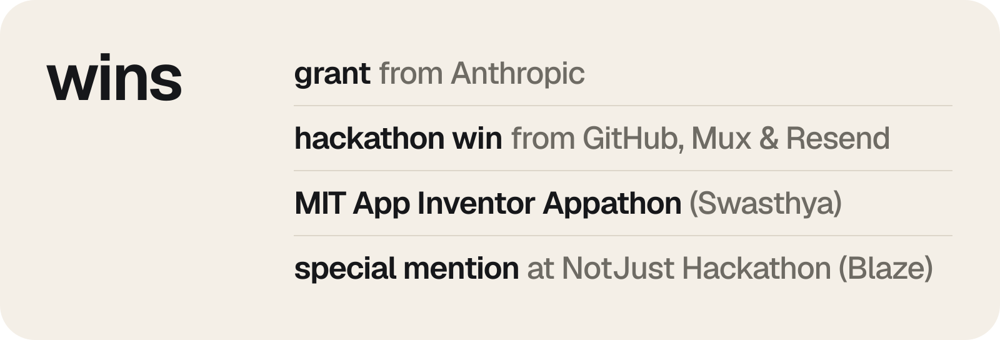

<a href="https://sarthakgupta.dev"><picture><source media="(max-width: 543px)" srcset="assets/header-phone.svg"><source media="(prefers-color-scheme: dark)" srcset="assets/header-dark.svg"></picture></a>

<a href="https://sarthakgupta.dev"><picture><source media="(prefers-color-scheme: dark)" srcset="assets/link-site-dark.svg"></picture></a>
<a href="https://x.com/sarthakguptadev"><picture><source media="(prefers-color-scheme: dark)" srcset="assets/link-x-dark.svg"></picture></a>
<a href="mailto:hi@sarthakgupta.dev"><picture><source media="(prefers-color-scheme: dark)" srcset="assets/link-mail-dark.svg"></picture></a>

<a href="https://appubot.com"><picture><source media="(max-width: 543px)" srcset="assets/appubot-phone.svg"><source media="(prefers-color-scheme: dark)" srcset="assets/appubot-dark.svg"></picture></a>

<a href="https://feedsheriff.com"><picture><source media="(max-width: 543px)" srcset="assets/feedsheriff-phone.svg"><source media="(prefers-color-scheme: dark)" srcset="assets/feedsheriff-dark.svg"></picture></a>

<a href="https://appgrowthkit.com"><picture><source media="(max-width: 543px)" srcset="assets/appgrowthkit-phone.svg"><source media="(prefers-color-scheme: dark)" srcset="assets/appgrowthkit-dark.svg"></picture></a>

<a href="https://doodlesapp.com"><picture><source media="(max-width: 543px)" srcset="assets/doodles-phone.svg"><source media="(prefers-color-scheme: dark)" srcset="assets/doodles-dark.svg"></picture></a>

<a href="https://untamed-app.com"><picture><source media="(max-width: 543px)" srcset="assets/untamed-phone.svg"><source media="(prefers-color-scheme: dark)" srcset="assets/untamed-dark.svg"></picture></a>

<a href="https://sarthakgupta.dev"><picture><source media="(max-width: 543px)" srcset="assets/wins-phone.svg"><source media="(prefers-color-scheme: dark)" srcset="assets/wins-dark.svg"></picture></a>
